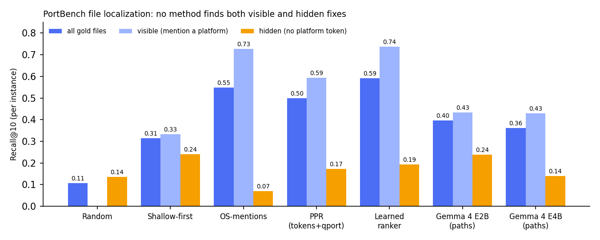

# PortBench: 1,619 real operating-system porting fixes for testing code localization

*A benchmark built from the public QNX port branches, with a file-localization task and baselines that show where simple heuristics stop working*

## Abstract
Agent benchmarks for software engineering start from an issue text and a failing test. Porting has neither. The code works on Linux, and the agent has to find the few files that must change for another operating system. We present PortBench, built from every fork in the public `qnx-ports` GitHub organisation, where QNX engineers port open-source projects to QNX 8.0: 150 projects (127 in C/C++) with 1,619 typed fix hunks, each tied to an upstream base commit so the task can be rebuilt exactly.

We define a file-localization task scored with Recall@k against the files the engineers actually changed. On 114 C/C++ instances (median 172 candidate files, 2 gold files), random ranking finds 11% of the gold files in its top 10. Counting platform macros in each file finds 55%. A rule-based porting scanner finds 46%. The benchmark splits in two. Gold files that already mention a platform are easy: 73% reach the top 10. Half of the instances (57 of 114) need changes in files with no platform token at all; keyword counting, by construction, ranks these last (7% against 14% for random). Propagating scanner findings over the `#include` graph with personalized PageRank raises this to 17%. Gemma 4 E2B on a laptop CPU reaches 24%, but so does ranking files by directory depth, and on a GPU it reaches 16%; shuffling its file list removes a third of its overall recall. E4B is worse. A learned ranker over cheap per-file features has the best recall at every cutoff (59% top 10, 72% top 20; significant at top 20), mostly from path and token features, while re-ranking its shortlist with Gemma 4, zero-shot or fine-tuned (QLoRA), does not help. Localizing platform-neutral files remains the open problem PortBench measures.

## 1. Introduction
SWE-bench measures whether an agent can resolve a GitHub issue, checked by tests. Porting a library to a new operating system, common in embedded and automotive work, looks different. There is no issue, no failing test until the toolchain is set up, and the code is correct on the platforms it already supports. The first and hardest step is **localization**: which of the hundreds of files depend on the platform?

Small local models cannot read a whole repository, so they must decide what to open. Graph tools such as this competition's `get_code_neighbors` are meant for that; PortBench offers a task, absent from existing benchmarks, on which to measure them.

QNX keeps its ports public: the `qnx-ports` organisation holds forks of 194 projects, from cJSON to OpenCV, whose QNX branches are small, real commits by engineers who know the target OS.

**Contributions**
1. **PortBench**: 150 instances (127 C/C++, 12 Rust, 11 other) with 1,619 typed fix hunks (1,296, 252 and 71). We also release the 443 branches in raw form, including older versions of the same project.
2. **A localization task** with an evaluation script, plus the same instances as agent tasks in JSONL (repository, base commit, problem statement, gold files and hunks).
3. **Baselines**: heuristics, include-graph PageRank, a learned ranker, Gemma 4 E2B and E4B, and a two-stage pipeline. Keyword counts find fixes next to existing platform code; files with no platform marker are found less often than by chance, and Gemma, zero-shot or fine-tuned, does no better than cheap signals.

## 2. Related work
- **Issue-driven repair benchmarks.** SWE-bench [1] and its variants start from an issue and check with tests.
- **Localization as a separate step.** Agentless [2] separates localization from repair; LocAgent [3] lets an LLM agent search a code graph. PortBench offers a localization target without issue text.
- **Preprocessor variability.** Liebig et al. [4] studied preprocessor variability in 40 C product lines; in our ports, 85.5% of code fixes add or edit a guard. We know of no public benchmark built from real porting commits.

## 3. Building the dataset
**Source.** `github.com/qnx-ports` has 232 repositories; 194 are forks with a known upstream, and 182 have branches named `qnx` or `nto` (450 branches).

**Diff.** For each branch, the GitHub compare API from the upstream default branch gives the diff from the merge base to the branch head: only commits upstream does not have. 443 comparisons succeeded (7 failed: deleted upstreams or no shared history). The median instance is 3.5 commits ahead of its merge base; 27 diffs hit API limits and are marked `truncated`.

**Keeping only porting changes.** A hunk is kept if at least one changed line that is not a comment mentions QNX (`qnx`, `__QNXNTO__`, `__nto`). We then drop:
- hunks in tests (306), documentation and CI (25), and files whose name contains `qnx` (21);
- hunks where QNX appears only in comments (71).

New QNX-only files are listed separately (27 C/C++ instances), since they cannot be located upstream.

**One instance per project.** We keep the branch with the most recent merge base, skipping branches named `broken`, `do_not_use`, `wip` or `test`: 150 instances.

**Fix types.** Each hunk gets one label from deterministic rules on its added and removed lines.

| Type | Rule | C/C++ hunks |
|---|---|---|
| guarded-subst | new QNX `#if` with replacement code | 548 |
| build | CMake, Autotools, Make, Meson, Bazel or GN file | 226 |
| guard-edit | QNX added to an existing condition | 192 |
| other | scripts, `.in` templates | 89 |
| include | only `#include` and guard lines added | 65 |
| disable | existing code wrapped in `#ifndef __QNX__` | 65 |
| edit | code changed without a new guard | 56 |
| packaging | install or test rules | 40 |
| qnx-code | more than 25 new lines | 15 |

Rust instances (252 hunks) are labelled `rust` and kept out of the C/C++ task.

**Audit.** We read two random samples of 40 C/C++ hunks.
- **First sample.** 36 were real porting changes; the misses (a copyright line, debug logging, test files) led to the comment-only filter and a test-file pattern.
- **Second sample.** 38 were real (the others: a debug `printf`, a commented-out test). 5 labels were wrong, all on continuation lines of a multi-line `#if`; a new rule moved 20 hunks to `guard-edit`, without a re-audit.

## 4. What porting fixes look like
- **Small.** A C/C++ port touches a median of 3 upstream files (mean 5.5) and 4 hunks. 36 of 127 instances change a single file.
- **Mostly preprocessor.** 805 of 941 source hunks (85.5%) add, edit or use a QNX guard.
- **Build files matter.** 23% of gold files are build files: CMake platform lists, `-lpthread` (QNX has threads in libc) and `-lsocket`.
- **Recent.** 73 of 150 instances have a merge base after June 2025.

## 5. Task and metrics
**File localization.** The input is the upstream repository at `base_commit` and the target "QNX 8.0". The candidates are C/C++ sources and build files, excluding tests, docs, CI and paths that already mention QNX. **Recall@k** (k = 1, 5, 10, 20) is the share of gold files, the upstream files the QNX branch changed, in the top k, averaged over instances.

**Why only localization.** Checking a patch needs the licensed QNX SDP; localization is scored exactly and offline. The gold hunks also allow patch-similarity scoring.

## 6. Baselines
Only the E4B run needs a GPU.
- **Random**: random order with a fixed seed. **Shallow-first**: files by directory depth, top level first.
- **OS-mentions**: counts platform tokens in each file after removing comments. Tokens include `__linux__`, `_WIN32`, `__APPLE__`, `__FreeBSD__`, `CMAKE_SYSTEM_NAME`, `host_machine.system`, and project macros such as `GLOG_OS_LINUX`. This baseline knows nothing about QNX.
- **Top-build + peers**: top-level build files first, then tokens of the Unix systems QNX most often joins (Apple, BSDs, Solaris).
- **qport**: a rule-based QNX porting scanner that we wrote. It knows the 1,967 QNX 8.0 C library functions, Linux-only APIs, platform lists without QNX, and Linux assumptions in build files. Files are scored by severity-weighted findings. Its rules were written on 29 of these projects, so we also report the rest ("unseen").
- **qport + OS-mentions**: the sum of the two scores.
- **Include-graph baselines.** We build a file graph per instance: an edge for each `#include` that resolves to a candidate (path-suffix match) and between `foo.c` and `foo.h`. The median graph has 442 edges and 10% isolated files. *PPR* runs personalized PageRank (teleport probability 0.3) seeded by token counts, or by tokens plus qport scores. *Interleave* alternates the OS-mentions and PPR(OS + qport) rankings.
- **Learned ranker**: logistic regression over 22 per-file features in five groups (path: depth, build file, header; tokens: platform and peer tokens; qport findings; content: size, system includes; graph: degree, neighbours' tokens, both PageRank scores; list in `features.py`), each instance weighted equally, scored with 5-fold project-level cross-validation over 3 fold assignments. **Two-stage**: Gemma 4 E4B re-ranks the ranker's top 30, seeing each file's `#include` and platform lines.
- **Gemma 4 E2B** (instruction-tuned, Q4_0 GGUF, llama.cpp on an 8-core laptop CPU, greedy decoding, thinking off). The prompt names the target (QNX 8.0, `__QNX__`, libsocket, a hint the other baselines lack) and asks for at most 20 paths. *Paths* gives the candidates in directory-walk order, top-level files first; above 400 files (38 instances) the list is cut and starts with the token-heavy and build files, so the order carries a keyword signal there; *Paths + lines* adds up to 6 platform lines from each of the 60 most token-heavy files. Median time is 45 s per prompt. **Gemma 4 E4B** uses the same prompts and decoding with 4-bit NF4 weights (transformers, one Kaggle T4; long prompts are read in 2,048-token chunks): 29 s per prompt, no failed prompt (public notebook: [E4B run](https://www.kaggle.com/code/zakariako/portbench-gemma-4-e4b-localization-baseline?scriptVersionId=366766106), [two-stage run](https://www.kaggle.com/code/zakariako/portbench-gemma-4-e4b-localization-baseline?scriptVersionId=366914492)).

## 7. Results
We fetched sources for 118 of the 127 C/C++ instances. Nine repositories whose GitHub size exceeds 800 MB were skipped (LLVM, PyTorch, TensorFlow, Bazel and others). In 4 instances every gold file was outside the candidate set. That leaves **114 instances**, with a median of 172 candidate files and 2 gold files.

| Method | R@1 | R@5 | R@10 | R@20 |
|---|---|---|---|---|
| Random | 0.012 | 0.076 | 0.107 | 0.193 |
| OS-mentions | 0.159 | 0.413 | 0.548 | 0.660 |
| Top-build + peers | 0.174 | 0.413 | 0.570 | 0.676 |
| qport | 0.090 | 0.377 | 0.463 | 0.539 |
| qport + OS-mentions | 0.137 | 0.401 | 0.545 | 0.692 |
| Learned ranker (cross-validated) | **0.195** | **0.464** | **0.591** | **0.719** |

On the 89 instances qport never saw (25 of its 29 projects are among the 114), the ranking is the same.

**The split.** A gold file is *visible* if it contains a platform token, *hidden* otherwise. 96 instances have visible gold files and 57 have hidden ones; 18 have only hidden ones. Pooled over files, 270 of 524 gold files are hidden, but four projects supply 173 of them (SuiteSparse alone 87, the same `#undef` in many files), so we average per instance: visible recall over the 96 instances with visible gold files, hidden over 57, all over 114; random is the expected 10/n.

| Method | visible R@10 | hidden R@10 | hidden R@20 | all R@10 | all R@20 |
|---|---|---|---|---|---|
| Random (expected) | – | 0.135 | – | 0.107 | 0.193 |
| Shallow-first | 0.333 | **0.240** | 0.283 | 0.314 | 0.398 |
| OS-mentions | 0.727 | 0.071 | 0.139 | 0.548 | 0.660 |
| PPR (tokens) | 0.650 | 0.097 | 0.189 | 0.509 | 0.634 |
| PPR (tokens + qport) | 0.594 | 0.173 | **0.363** | 0.500 | 0.658 |
| Interleave | 0.677 | 0.139 | 0.284 | 0.534 | 0.683 |
| Learned ranker | **0.737** | 0.194 | 0.338 | **0.591** | **0.719** |
| Gemma 4 E2B, paths | 0.434 | 0.238 | 0.353 | 0.397 | 0.474 |
| Gemma 4 E2B, paths, T4, shuffled | 0.213 | 0.173 | 0.202 | 0.233 | 0.289 |
| Gemma 4 E2B, paths + lines | 0.497 | 0.236 | 0.286 | 0.443 | 0.505 |
| Gemma 4 E4B, paths | 0.429 | 0.140 | 0.183 | 0.362 | 0.429 |
| Gemma 4 E4B, paths + lines | 0.542 | 0.117 | 0.152 | 0.429 | 0.488 |

Keyword counting ranks hidden files *below* chance, because visible files fill the top of the list. The graph helps: half of the hidden gold files (135/270) have a token-bearing neighbour, against 37% of all hidden candidates, and 12% carry a qport finding against 2%. Seeding PageRank with both signals more than doubles hidden recall. But it pulls visible files down, and no ranking wins on both groups.

**Gemma 4.** E2B reaches hidden R@10 = 0.238 on CPU, but shallow-first reaches 0.240, and in 46 of 114 answers E2B returns paths in input order. A T4 control ([notebook](https://www.kaggle.com/code/zakariako/portbench-gemma-4-e4b-localization-baseline?scriptVersionId=367084699)) shows how much the order matters: with the same lines shuffled twice, R@10 falls from 0.366 to 0.233 (p = 0.0003) and visible recall from 0.417 to 0.213. Hidden recall does not fall (0.161 and 0.173, p = 0.14), but the CPU figure of 0.238 is not reproduced on T4, so we do not claim an E2B advantage on hidden files. E4B copies less (12 of 114) but is worse: 0.362 overall and 0.140 on hidden files; the runs differ in runtime and 4-bit format, so this is not a pure size effect. Adding platform lines helps both models on visible files only. Neither model beats keyword counting overall.

**Learned ranker.** It has the best mean at every cutoff: R@10 = 0.591 (95% bootstrap interval 0.522 to 0.661) and R@20 = 0.719 (0.653 to 0.779), stable across fold assignments (0.584 to 0.597). Per-instance sign tests: at R@20 it beats OS-mentions (29 wins, 11 losses, p = 0.006), qport + OS-mentions (p = 0.005) and top-build + peers (p = 0.03); at R@10 it beats qport + OS-mentions (p = 0.03) but not OS-mentions (p = 0.14) or top-build + peers (p = 0.43). Dropping feature groups shows where the signal is: without path features hidden recall falls from 0.194 to 0.117; without token features visible recall falls from 0.737 to 0.682; without graph features almost nothing changes (R@10 0.589), as the graph overlaps with tokens and qport. Re-ranking the top 30 with Gemma 4 E4B lowers R@10 from 0.584 (fold assignment 0) to 0.415; fusing both orders gives 0.554.

**Fine-tuning.** A QLoRA adapter for E2B (4-bit, 2 epochs, about 170 training prompts per fold, same project-level folds, [notebook](https://www.kaggle.com/code/zakariako/portbench-gemma-4-e4b-localization-baseline?scriptVersionId=366930270)) learns to output the shortlist's gold files. Training loss falls from about 0.65 to 0.27, but on held-out projects it does not help: R@10 is 0.561, against 0.560 for zero-shot E2B on the same prompts and 0.584 for the ranker; R@1 drops from 0.180 to 0.131 (p = 0.03); and the 2.2 files it selects on average are less precise than the ranker's top files (0.258 against 0.353, p = 0.003). With so little data it overfits.

## 8. Discussion
**Visible and hidden fixes.** Visible fixes usually extend an existing list such as `#if defined(__APPLE__) || defined(__FreeBSD__)`. We sorted the 183 hidden gold files outside SuiteSparse by their added lines: replacement code inside a QNX branch (55), build or install rules (43), a clash with a macro the QNX headers define, such as `MIN`, `MAX` or `_INT32` (31), a missing type or constant such as `cpu_set_t` (22), code switched off (20), and a missing `#include` such as `<sys/time.h>` (12).

Only 12% of hidden files get any scanner finding. Most hidden fixes depend on facts about QNX's headers (which names they define, what they include) rather than on missing functions. Linking a file to such a fact needs symbol-level graphs, like this competition's, and a model that knows the target headers; our file-level PageRank only spreads scores.

**How an agent would use this.** A cheap learned ranker gives the shortlist; a model earns its cost only if it beats directory depth on hidden files, which neither Gemma model does zero-shot. PortBench scores visible and hidden files separately, so progress on the hard group is not masked by the easy one.

## 9. Limitations
- **One reference port.** Another valid port might touch other files, so recall is a lower bound.
- **Rule-based filtering.** 2 to 4 hunks in 40 were not porting changes in our audits; 15 of the 114 evaluated diffs are truncated, so a few gold files may be missing.
- **One target OS.** QNX is the only large public collection of port branches we found; the scripts take any organisation name.
- **Uneven instances.** A few projects repeat one fix across many files (SuiteSparse: 87 gold files). We report per-instance averages; pooled file counts overweight these projects.
- **Possible contamination.** The branches are public. Gemma 4 E2B is no better on the 47 instances based after June 2025 (R@10 0.385 against 0.406), and `base_date` lets users select them.
- **No executable evaluation, two small models.** We ran Gemma 4 E2B and E4B (4-bit, different runtimes), without tools; the fine-tune has about 170 prompts per fold. The JSONL tasks are ready for an agent harness.

## 10. Availability
Scripts, dataset, JSONL tasks and per-instance results are at https://github.com/zak01E/portbench (code under MIT; hunks are short excerpts under each project's licence, listed per instance). Everything can be rebuilt from public GitHub data.

**Use of AI tools.** An AI assistant (Claude) wrote most of the collection and evaluation code and helped draft this text. The author checked the audits, the numbers and the claims against the released data.

## References
[1] C. E. Jimenez et al. SWE-bench: Can Language Models Resolve Real-World GitHub Issues? ICLR 2024.
[2] C. S. Xia et al. Agentless: Demystifying LLM-based Software Engineering Agents. arXiv:2407.01489, 2024.
[3] Z. Chen et al. LocAgent: Graph-Guided LLM Agents for Code Localization. ACL 2025.
[4] J. Liebig et al. An Analysis of the Variability in Forty Preprocessor-Based Software Product Lines. ICSE 2010.
[5] QNX. qnx-ports GitHub organisation. https://github.com/qnx-ports (accessed 6 November 2026).
