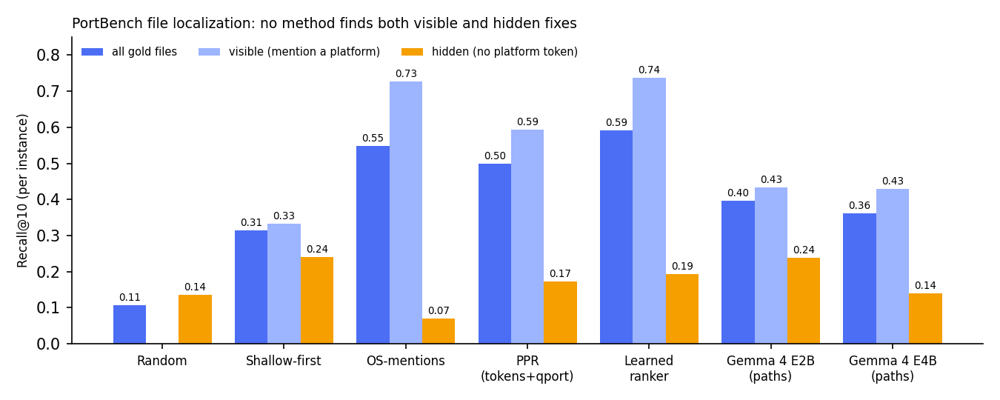

# PortBench

Real operating-system porting fixes, mined from the public QNX port repositories
(https://github.com/qnx-ports), packaged as a benchmark for coding agents.

Each instance is one upstream open-source project. It records:
- the upstream commit the QNX engineers started from (`base_commit`);
- the QNX branch that ports it to QNX 8.0;
- the hunks that make up the port, each labelled with a fix type.

The main task is **file localization**: given the repository at `base_commit` and the target
"QNX 8.0", rank the files that need a change.

## Files
| File | Content |
|---|---|
| `data/portbench.json` | Instances, one per project, with labelled fix sites (`+`/`-` lines included) |
| `data/portbench_tasks.jsonl` | The same instances as agent tasks: repo, base commit, problem statement, gold files and sites |
| `data/all_branches.json` | Every QNX branch, including older versions of the same project |
| `data/eval_files.json` | Per-instance results of the baselines |
| `data/eval_graph.json` | Per-instance results of the include-graph baselines |
| `data/gemma_e2b_results.json`, `data/gemma_e4b_results.json` | Gemma 4 E2B / E4B answers, rankings and timings per instance |
| `data/llm_inputs.json` | Candidate files and platform lines per instance, input of `gemma_baseline.py` |
| `data/forks.json` | The `qnx-ports` forks with their upstream repositories |

## Size and results
- 194 forks, 450 QNX branches, 150 instances, 1,619 fix hunks.
- 127 instances are C/C++, with 1,296 hunks. 85.5% of the hunks in source files add or edit a preprocessor guard.
- File localization on 114 C/C++ instances (median 172 candidate files, 2 gold files):

| Method | R@1 | R@5 | R@10 | R@20 |
|---|---|---|---|---|
| Random | 0.012 | 0.076 | 0.107 | 0.193 |
| OS-mentions | 0.159 | 0.413 | 0.548 | 0.660 |
| Top-build + Unix peers | 0.174 | 0.413 | 0.570 | 0.676 |
| qport (rule-based scanner) | 0.090 | 0.377 | 0.463 | 0.539 |
| qport + OS-mentions | 0.137 | 0.401 | 0.545 | 0.692 |

Gold files that already mention a platform are easy (OS-mentions puts 73% in the top 10, averaged per
instance). 57 of the 114 instances also need changes in files with no platform token, where OS-mentions does
worse than random (R@10 0.071 against 0.135). Personalized PageRank over the `#include` graph, seeded with
OS-mentions and qport scores, raises this to 0.173 (`python graph_eval.py`). Gemma 4 E2B (llama.cpp on a laptop CPU)
reaches 0.238 on these files from the file paths alone, but ranking files by directory depth reaches 0.240
(`order_baselines.py`), and Gemma 4 E4B (4-bit, Kaggle T4) does worse (0.140). Hidden fixes sit in shallow, central files.
E4B notebook: https://www.kaggle.com/code/zakariako/portbench-gemma-4-e4b-localization-baseline

A learned ranker (`features.py`, `learn_rank.py`: logistic regression over 22 per-file features, project-level
cross-validation) beats every single heuristic: R@10 0.591, R@20 0.719. Include-graph PageRank is its second strongest
feature. Re-ranking its top 30 with Gemma 4 E4B (`export_rerank_inputs.py`, `gemma_rerank.py`,
`gemma_rerank_analyze.py`, notebook `notebooks/gemma_e4b_rerank.ipynb`) lowers R@10 to 0.415.

 Details are in [PAPER.md](PAPER.md).

## Rebuild from scratch
You need the GitHub CLI (`gh`) and Python 3.10 or newer.

```bash
python collect.py <list of qnx-ports repos as TSV>   # forks, upstreams, QNX branches
python extract.py                                    # GitHub compare API: merge base -> QNX branch
python label.py                                      # keep QNX hunks, label fix types
python make_tasks.py                                 # export JSONL tasks
python fetch_src.py <workdir> 150000                 # upstream sources at base commit (C/C++ only)
python evaluate.py                                   # localization baselines
python graph_eval.py                                 # include-graph baselines (PageRank)
```

The `qport` baseline is in `baselines/qport`. To get a Gemma 4 baseline on a GPU (for example a Kaggle
notebook), run `python export_llm_inputs.py` and then `python gemma_baseline.py data/llm_inputs.json <model dir>`.
On a CPU, start `llama-server -m gemma-4-E2B-it-Q4_K_M.gguf --port 8080` and pass `http://127.0.0.1:8080` instead of the model dir.

## Fix types
`guarded-subst` (new `#ifdef __QNX__` branch with replacement code), `guard-edit` (QNX added to an
existing `#if`), `disable` (code wrapped in `#ifndef __QNX__`), `include`, `edit`, `qnx-code`
(more than 25 new lines), `build`, `packaging` (test or install rules), `rust`, `other`.

## Licence
Scripts: MIT. The dataset stores pointers (repository, commits) and short excerpts of each
project's diff. Each excerpt stays under its project's licence, which is listed per instance.
